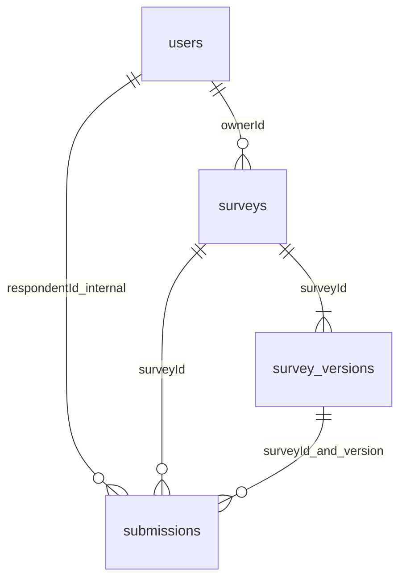

# MongoDB 数据库设计

所有持久化业务数据只使用 MongoDB；没有关系数据库或现成问卷系统。初始化定义在 `source/app/db/mongo.py::SCHEMAS/initialize`，严格 `$jsonSchema` 验证必填字段、主要 BSON 类型和数组上限。更细的题型约束在 Pydantic/发布验证器中维护，避免两份规则分歧。数据库直连管理员可绕开服务修改 sealed 数据，因此应用数据库账号只供服务使用；不可变性由应用写入口和 CAS 保证，并非 Mongo JSON Schema 的跨更新比较功能。

## 四集合与类型

|集合|字段（BSON）|用途|
|---|---|---|
|users|_id:ObjectId; username:string; passwordHash:string; createdAt:date; schemaVersion:int=1; sessionVersion:int（默认1）|归一化账号、Argon2id哈希、全会话撤销版本|
|surveys|_id/ownerId:ObjectId; publicId/title/description:string; status:draft/published/closed; publishedVersion/draftVersion:int或null; submissionPolicy:latest_only/multiple; deadlineAt:date或null; createdAt/updatedAt:date; schemaVersion:int|问卷元数据与权威公开指针|
|surveys（并发补充）|writeRevision:int; hasSubmissions:bool|事务与状态变更争用同一文档；首次成功提交锁定策略|
|survey_versions|_id/surveyId:ObjectId; version:int; schemaVersion:int; revision:int; state:draft/sealed; settings:{anonymous:bool}; questions:array; createdAt:date; sealedAt:date或null|不可变内容快照，草稿独立指针|
|submissions|_id/surveyId/respondentId:ObjectId; surveyVersion:int; anonymousAtSubmission:bool; requestId:string(UUID); payloadDigest:string(SHA256); answers:array; submittedAt:date; schemaVersion:int|每次逻辑成功提交追加一份记录|

questions 内嵌 `{id,type,title,required,options:[{id,label}],validation:{},routingRules:[]}`；answers 内嵌 `{questionId,value}`。完整可执行固定样例在 `source/tests/fixtures.py`，真实 BSON 插入/读取在 `source/tests/integration/test_core.py`。HTTP 统一将 ObjectId 转字符串、UTC Date 转 ISO8601；反向引用统一 `oid()` 转换。禁止将原始字符串 ID 写成 BSON 关联字段。

四集合实际Pydantic文档模型为 `source/app/models/documents.py` 的UserDocument/SurveyDocument/VersionDocument/SubmissionDocument，`to_bson()`保留ObjectId与UTC datetime而非JSON字符串。请求模型位于domain.py，与数据库格式分离。

选择嵌入：问卷单个版本的题目/选项/规则共同读取、共同冻结，更新单文档可用 revision CAS；答卷答案与提交共同创建。选择引用：用户、问卷、多个版本、无限增长的提交分别独立管理。限制每卷100题、每题50选项/20规则、题目500字、选项300字、文本10000码点、请求2MiB，避免接近 BSON 16MiB。若使用关系式拆表，需要多表连接和版本快照装配；此处文档边界就是业务一致性边界，更适合 MongoDB。并非关系数据库无法实现，课程明确禁止使用，模型也未机械模拟关系表。

## 索引

|集合|索引|理由/成本|
|---|---|---|
|users|username unique|防止归一化账号重复|
|surveys|publicId unique; ownerId+createdAt desc|分享定位、个人工作台|
|survey_versions|surveyId+version unique|历史版本稳定引用，并发派生防重|
|submissions|surveyId+respondentId+requestId unique|幂等不误杀真实重复填写|
|submissions|surveyId+submittedAt desc+_id desc|确定性最新记录选择|
|submissions|surveyId+surveyVersion+submittedAt desc|版本历史列表|
|submissions|respondentId+submittedAt desc|本人提交查询|

额外索引增加写成本，但匹配实际查询。latest_only 聚合先按整份问卷 sort/group respondentId，再 match surveyVersion；禁止先按版本过滤。同毫秒提交用 _id 排序，提供确定性而非严格网络到达顺序。事务提交时间也不等于客户端点击时间。

## 版本、恢复与匿名

schemaVersion=文档格式；version/surveyVersion=问卷内容，不混用。新建 V1 草稿，派生 V2 时复制旧版本，草稿修订用 revision CAS。发布先校验并 sealed，再切 surveys.publishedVersion；中间失败只需重试 publish。公开端只读取指针所指 sealed 版本。旧版填写提交遇切版返回409，旧答案按原版本解释。标题/说明为问卷级可变元信息；题目/匿名设置是版本快照。

匿名不等于免登录，内部 respondentId 用于跨版本去重，所有者输出使用 allowlist DTO，匿名时排除账号 ID、requestId、digest、用户名。anonymousAtSubmission 保证后续实名版本不解除历史匿名；自由文本可能由填写者自行透露身份。无导出/调试端点提供内部文档。

重复策略位于 surveys，首份成功答卷事务设置 hasSubmissions。每次新 requestId 追加，重试相同内容返回原 ID；同键不同内容409。historical_raw 展示指定版本全部记录；current_effective 在全卷选最新或全部，再按版本统计。

参见 ADR 001 的一致性代价与第二阶段影响。初始化重复执行不删数据，测试仅销毁本次随机分配的 survey_test_ 数据库。
