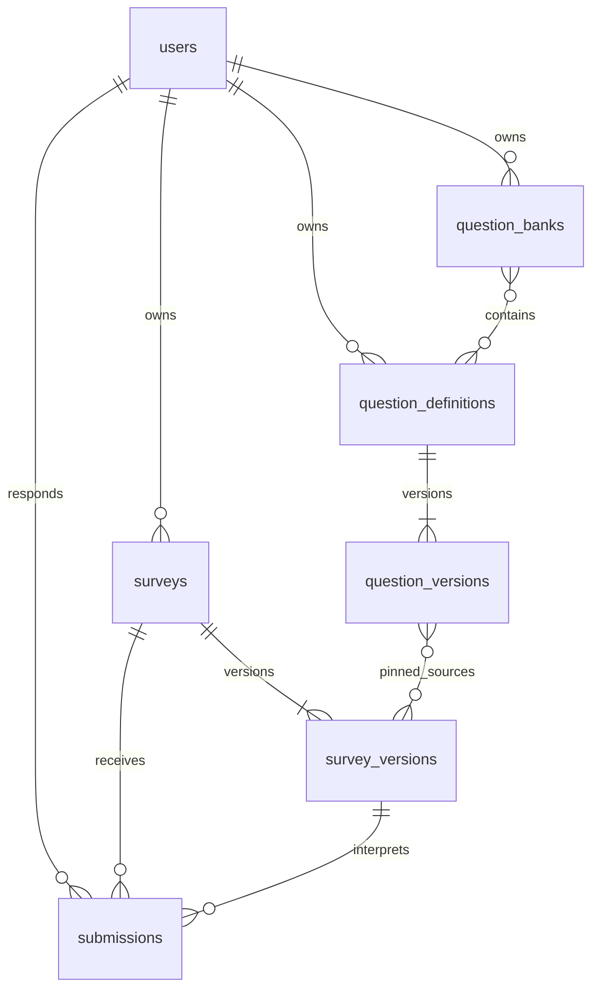

# MongoDB 数据库设计

系统以问卷版本为填写和历史解释的单位，以独立题目版本支持跨问卷复用。数据保存在七个集合中，题目配置和答案采用有界嵌入，账号、版本与持续增长的答卷通过标识关联。

验证器和索引位于 [db/mongo.py](../source/app/db/mongo.py)，BSON 映射位于 [models/documents.py](../source/app/models/documents.py)。四集合到七集合的方案比较见[数据库演进](project2/database-evolution.md)。

## 集合与字段

### 账号、问卷和答卷

|集合|主要 BSON 字段|职责|
|---|---|---|
|`users`|`_id:ObjectId`；username、passwordHash；createdAt；sessionVersion（默认 1）|归一化账号、密码哈希与会话撤销版本|
|`surveys`|`_id/ownerId:ObjectId`；publicId、title、description；status；publishedVersion、draftVersion；submissionPolicy；deadlineAt；createdAt、updatedAt|问卷元信息、公开链接与版本指针|
|`surveys` 并发与贡献字段|`writeRevision:int`、`hasSubmissions:bool`、`statisticsContribution:bool`（缺省 false）|协调状态变更、锁定重复策略、控制统计贡献|
|`survey_versions`|`_id/surveyId:ObjectId`；version、revision；state=draft/sealed；settings；questions；createdAt、sealedAt|问卷内容、匿名设置及路由快照|
|`submissions`|`_id/surveyId/respondentId:ObjectId`；surveyVersion；anonymousAtSubmission；requestId；payloadDigest；answers；submittedAt|每次成功逻辑提交及其版本、身份快照|

集合文档使用 `schemaVersion=1`。时间为 UTC Date，关联标识为 ObjectId；HTTP 返回时分别转换为 ISO8601 和字符串。publishedVersion、draftVersion、deadlineAt、sealedAt 按状态允许 null，具体必填字段与类型由验证器定义。

`questions[]` 嵌入 `{id,type,title,required,options,validation,routingRules,source?}`，`answers[]` 嵌入 `{questionId,value}`。固定题目样例见 [fixtures.py](../source/tests/fixtures.py)，读写测试见 [test_core.py](../source/tests/integration/test_core.py)。

### 题目与题库

|集合|主要 BSON 字段|职责|
|---|---|---|
|`question_definitions`|`_id/ownerId:ObjectId`；currentVersion；visibility=private/shared；sharedWith；forkedFrom；archived；revision；createdAt、updatedAt|稳定题目身份、共享范围与当前版本指针|
|`question_versions`|`_id/questionId:ObjectId`；version；parentVersion；changeType=create/update/restore；restoredFromVersion；content；createdBy；createdAt|某一版具体内容与演进关系|
|`question_banks`|`_id/ownerId:ObjectId`；name、description；items；revision；createdAt、updatedAt|个人题库及有界成员引用|

题目版本的 content 包含 type、title、required、options 和 validation。题库成员为 `{questionId,pinnedVersion?}`；固定成员选用指定版，未固定成员在选题时解析 currentVersion。forkedFrom 为 `{questionId,questionVersion}` 或 null，用于记录独立派生的来源。



问卷版本与答卷通过 `(surveyId, version)` 关联，题目版本与问卷实例通过 source 关联；图中的关系由对应标识字段表达。

## 嵌入、来源与版本

题目、选项和路由通常一起读取、一起发布，因此嵌入问卷版本；一份答卷的答案也整体保存。历史版本和答卷独立增长，分别存储。这个组织方式使完整问卷读取和版本冻结保持直观。

`questions[].id` 是问卷内实例 ID，`source.questionId` 是跨问卷稳定身份。来源结构为：

```text
source: {
  questionId: ObjectId,
  questionVersion: int
}
```

导入生成新的局部 ID，将所选版本的内容复制到草稿，每个问卷版本至多引用同一全局题目一次。显式替换保留局部 ID 及其他题目的入边，清空本题出边后重新验证整卷。核心内容按来源版本校验；解除关联后，该实例成为本地题。问卷的 routingRules 独立配置，题库版本只保存可跨问卷复用的内容。

题目版本在事务中按 currentVersion CAS 加一，并以复合唯一索引保证版本号唯一。parentVersion 指向同题的派生起点；恢复复制选定内容追加新版本，并记录 restoredFromVersion；fork 创建新题目身份，通过 forkedFrom 记录跨题来源。归档和撤销共享影响后续引用，已导入的快照继续使用原内容。

`schemaVersion` 表示文档格式；问卷 version/surveyVersion 和题目的 questionVersion 表示内容版本；revision 用于并发修改。这些字段分别处理格式、历史和当前编辑状态。

### 配置规模

|对象|上限|
|---|---|
|每份问卷|100 题|
|每道题|50 个选项、20 条路由规则|
|题目标题 / 选项标签|500 / 300 字符|
|文本答案|10,000 个 Unicode 码点|
|每个题库|200 个成员|
|共享用户|100 个|
|请求体|2 MiB|

## 索引

|集合|索引|用途|
|---|---|---|
|users|username，唯一|归一化账号唯一性|
|surveys|publicId，唯一；ownerId + createdAt DESC|公开链接与个人列表|
|survey_versions|surveyId + version，唯一|问卷历史版本定位|
|survey_versions|questions.source.questionId + questions.source.questionVersion|精确来源反查|
|submissions|surveyId + respondentId + requestId，唯一|幂等提交|
|submissions|surveyId + submittedAt DESC + _id DESC|确定性最新答卷选择|
|submissions|surveyId + surveyVersion + submittedAt DESC|版本历史列表|
|submissions|respondentId + submittedAt DESC|本人提交查询|
|question_definitions|ownerId + updatedAt DESC；sharedWith|个人和共享题目列表|
|question_versions|questionId + version，唯一|题目历史与精确版本读取|
|question_banks|ownerId + updatedAt DESC|个人题库列表|

来源复合索引的两个键经过同一 questions 数组，查询用 `$elemMatch` 绑定同一元素。例如，Q/v1 和 R/v2 同时出现时，不应匹配 Q/v2。`activeOnly=true` 在初始 `$match` 中过滤 archived=false，搜索、排序、分页与 total 共用同一过滤结果。

索引依据主要访问路径设置，会带来相应的存储与写入开销。统计按 submittedAt、_id 排序，在同一时间下仍能确定最新记录。

## 事务、发布与匿名

统一保存通过一个事务更新 surveys 元信息、survey_versions 草稿和来源检查涉及的题目修订。草稿通过 expectedRevision 检查编辑冲突，失败时整体回滚。选题时更新定义 revision，使导入与共享撤销、归档按事务顺序执行。

发布先冻结 sealed，再切换 publishedVersion；中断后沿用 revision 重试。公开填写读取指针所指的冻结快照，提交版本过期时返回 409。标题和说明属于问卷级元信息，题目与匿名设置随版本保存。

首次成功提交设置 hasSubmissions，锁定 submissionPolicy。新的 requestId 追加答卷；相同键和内容返回原记录，内容不同返回冲突。服务内部保留 respondentId 用于去重，所有者列表按 anonymousAtSubmission 选择身份字段。实名用户名由当前页批量关联 users；账号缺失时返回 null。

## 统计口径

`current_effective` 按各问卷的 submissionPolicy 选择有效答卷，`historical_raw` 查询原始提交。对于 latest_only，先跨问卷版本选择每位填写者的最新记录，再筛选目标版本或来源；multiple 保留每份提交。跨问卷统计在 MongoDB 中通过 `$lookup`、`$filter`、`$group`、`$facet` 聚合。

|字段|含义|
|---|---|
|surveyCount|授权及小样本抑制后，有当前口径所选提交的去重问卷数|
|submissionCount|包含目标题实例的所选答卷次数|
|answeredCount|其中实际包含目标题答案的次数|
|usage.total|当前用户可见的问卷版本引用记录数|

使用了题目但尚无提交的问卷不计 surveyCount；旧版提交全部被新版替代时，有效口径下也不计。保留的答卷跳过目标题目时，仍可计入 surveyCount 和 submissionCount，answeredCount 为零。一个问卷的多个版本可形成多条使用记录，但参与统计时按 surveyId 去重。

统计单位为提交次数。选择题返回选项频数；数字题返回均值及完整覆盖的半开区间：`(-∞,0)`、`[0,18)`、`[18,30)`、`[30,45)`、`[45,60)`、`[60,121)`、`[121,+∞)`。空样本均值为 null，分布以 answeredCount 为分母。不同题目版本分别统计。

`mine` 只汇总本人问卷，`consented_shared` 加入 statisticsContribution=true 的问卷。每份外部问卷在当前口径下至少 3 次实际回答后参与聚合。跨问卷结果包含计数、选项频数和数值分布，文本题只返回回答计数。原始答卷和填写者身份由单问卷管理接口按权限展示。使用关系展示自己的版本与当前可公开访问版本。

统计采用实时聚合，样本阈值用于筛选参与共享统计的外部问卷。查询检查及后续验证见[测试记录](project2/test-report.md)。

## 旧数据与升级

source 可选，statisticsContribution 缺省按 false 解释，文档格式继续使用 schemaVersion=1。初始化与迁移安装验证器和索引，保留已有版本与答卷。已发布快照的不可变性由应用写入路径维护，数据库运维权限另行配置。操作步骤见[升级说明](project2/migration.md)，发布协议的设计依据见[ADR 001](adr/001-consistency.md)。
