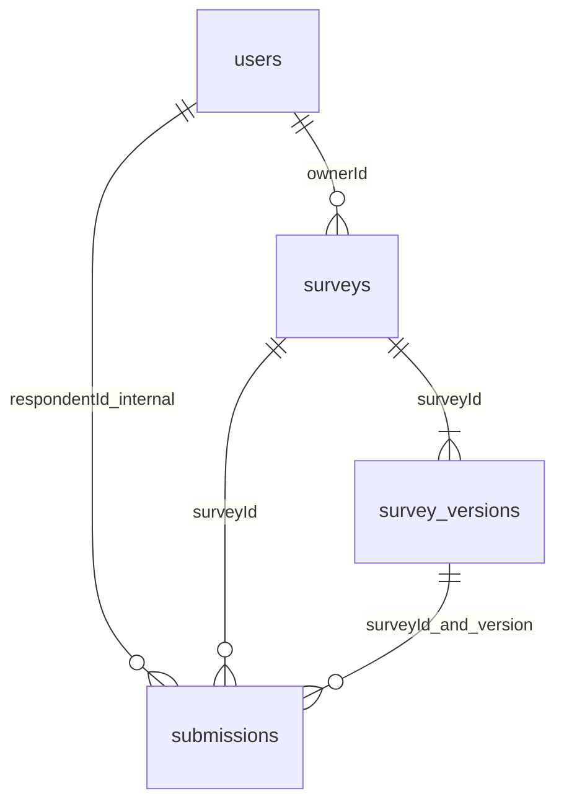

# MongoDB 数据库设计

系统使用MongoDB保存业务数据，由users、surveys、survey_versions和submissions四个集合组织账号、问卷、内容版本及填写记录。初始化代码位于`source/app/db/mongo.py`，通过`$jsonSchema`约束必填字段、BSON类型和数组规模。题型规则由Pydantic模型与业务校验器处理，已发布内容的冻结由服务层状态检查和CAS更新实现。

## 四集合与类型

|集合|字段（BSON）|用途|
|---|---|---|
|users|_id:ObjectId; username:string; passwordHash:string; createdAt:date; schemaVersion:int=1; sessionVersion:int（默认1）|归一化账号、Argon2id哈希、全会话撤销版本|
|surveys|_id/ownerId:ObjectId; publicId/title/description:string; status:draft/published/closed; publishedVersion/draftVersion:int或null; submissionPolicy:latest_only/multiple; deadlineAt:date或null; createdAt/updatedAt:date; schemaVersion:int|问卷元数据与权威公开指针|
|surveys（并发补充）|writeRevision:int; hasSubmissions:bool|事务与状态变更争用同一文档；首次成功提交锁定策略|
|survey_versions|_id/surveyId:ObjectId; version:int; schemaVersion:int; revision:int; state:draft/sealed; settings:{anonymous:bool}; questions:array; createdAt:date; sealedAt:date或null|不可变内容快照，草稿独立指针|
|submissions|_id/surveyId/respondentId:ObjectId; surveyVersion:int; anonymousAtSubmission:bool; requestId:string(UUID); payloadDigest:string(SHA256); answers:array; submittedAt:date; schemaVersion:int|每次逻辑成功提交追加一份记录|

questions内嵌`{id,type,title,required,options:[{id,label}],validation:{},routingRules:[]}`，answers内嵌`{questionId,value}`。固定样例见[source/tests/fixtures.py](../source/tests/fixtures.py)，BSON写入与读取测试见[test_core.py](../source/tests/integration/test_core.py)。HTTP响应将ObjectId转换为字符串、UTC Date转换为ISO8601，写入关联字段时通过oid()统一转换为ObjectId。

四集合实际Pydantic文档模型为 `source/app/models/documents.py` 的UserDocument/SurveyDocument/VersionDocument/SubmissionDocument，`to_bson()`保留ObjectId与UTC datetime而非JSON字符串。请求模型位于domain.py，与数据库格式分离。

题目、选项和规则通常共同读取和发布，因此嵌入同一版本文档；一次提交中的答案也随答卷整体保存。用户、问卷、历史版本和持续增长的提交记录通过标识符关联，分别管理。

每份问卷最多100题，每题最多50个选项、20条规则；题目标题最多500字、选项标签300字、文本答案10000码点，请求体上限2MiB。这些限制用于控制单文档规模。

若按规范化关系表拆分题目、选项和规则，读取完整问卷时需要关联多个表，并维护历史版本的对应关系。本项目以完整问卷版本为主要访问单位，文档嵌入更贴近业务的读取和冻结方式，也符合课程采用MongoDB的要求。

## 索引

|集合|索引|理由/成本|
|---|---|---|
|users|username unique|防止归一化账号重复|
|surveys|publicId unique; ownerId+createdAt desc|分享定位、个人工作台|
|survey_versions|surveyId+version unique|历史版本稳定引用，并发派生防重|
|submissions|surveyId+respondentId+requestId unique|区分幂等重试与新一轮填写|
|submissions|surveyId+submittedAt desc+_id desc|确定性最新记录选择|
|submissions|surveyId+surveyVersion+submittedAt desc|版本历史列表|
|submissions|respondentId+submittedAt desc|本人提交查询|

索引按个人列表、分享链接、版本查询、幂等写入和统计聚合等访问方式设置。latest_only先对整份问卷sort/group respondentId，再match surveyVersion；相同submittedAt使用_id确定排序结果。索引会增加写入成本，后续可结合数据量和查询性能继续调整。

## 版本、恢复与匿名

schemaVersion=文档格式；version/surveyVersion=问卷内容，不混用。新建 V1 草稿，派生 V2 时复制旧版本，草稿修订用 revision CAS。发布先校验并 sealed，再切 surveys.publishedVersion；中间失败只需重试 publish。公开端只读取指针所指 sealed 版本。旧版填写提交遇切版返回409，旧答案按原版本解释。标题/说明为问卷级可变元信息；题目/匿名设置是版本快照。

填写者登录后提交，系统内部使用respondentId完成跨版本去重。创建者查看答卷时，接口依据anonymousAtSubmission控制身份字段；匿名记录隐藏账号ID和用户名，requestId与摘要用于内部幂等处理。后续版本修改匿名设置时，已有答卷继续沿用提交时的设置。

非匿名答卷通过respondentId关联users._id，在响应中补充respondentUsername。list_owner批量读取当前页非匿名用户的_id和username，使用默认_id索引并沿用列表snapshot事务。用户名是读取时的当前值；关联账号缺失时返回null，保留原respondentId。该字段由查询生成，submissions继续保存用户ID。

重复策略位于 surveys，首份成功答卷事务设置 hasSubmissions。每次新 requestId 追加，重试相同内容返回原 ID；同键不同内容409。historical_raw 展示指定版本全部记录；current_effective 在全卷选最新或全部，再按版本统计。

事务和发布恢复的设计依据见[ADR 001](adr/001-consistency.md)。初始化脚本支持重复执行，测试库使用独立的survey_test_命名空间。
