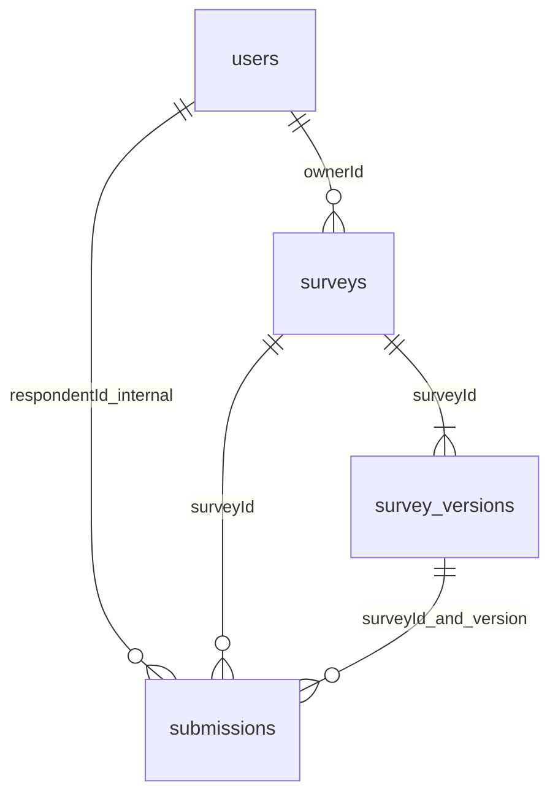
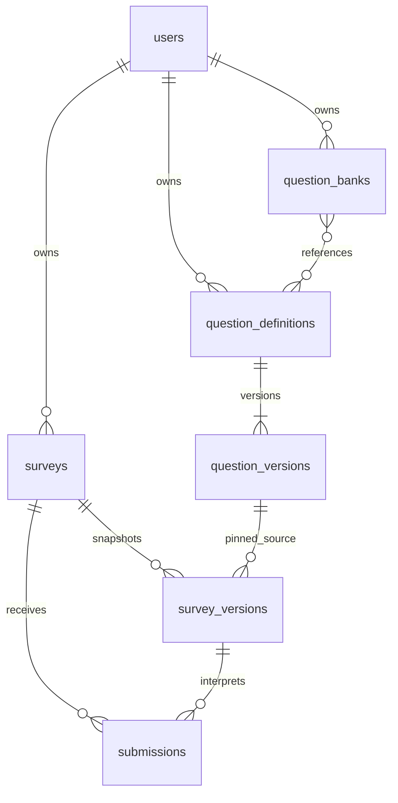

# MongoDB 数据库设计

当前规范：Project 2 / 七集合。第一阶段原貌可由 Git Tag `project1-baseline-61e2263` 恢复；本阶段演进论证见 [database-evolution](project2/database-evolution.md)。

系统使用MongoDB保存业务数据，保留users、surveys、survey_versions和submissions四个集合组织账号、问卷、内容版本及填写记录，并增量加入question_definitions、question_versions和question_banks。初始化代码位于`source/app/db/mongo.py`，通过`$jsonSchema`约束必填字段、BSON类型和数组规模。题型规则由Pydantic模型与业务校验器处理，已发布内容的冻结由服务层状态检查和CAS更新实现。

## 四集合与类型

|集合|字段（BSON）|用途|
|---|---|---|
|users|_id:ObjectId; username:string; passwordHash:string; createdAt:date; schemaVersion:int=1; sessionVersion:int（默认1）|归一化账号、Argon2id哈希、全会话撤销版本|
|surveys|_id/ownerId:ObjectId; publicId/title/description:string; status:draft/published/closed; publishedVersion/draftVersion:int或null; submissionPolicy:latest_only/multiple; deadlineAt:date或null; createdAt/updatedAt:date; schemaVersion:int|问卷元数据与权威公开指针|
|surveys（并发补充）|writeRevision:int; hasSubmissions:bool|事务与状态变更争用同一文档；首次成功提交锁定策略|
|survey_versions|_id/surveyId:ObjectId; version:int; schemaVersion:int; revision:int; state:draft/sealed; settings:{anonymous:bool}; questions:array; createdAt:date; sealedAt:date或null|不可变内容快照，草稿独立指针|
|submissions|_id/surveyId/respondentId:ObjectId; surveyVersion:int; anonymousAtSubmission:bool; requestId:string(UUID); payloadDigest:string(SHA256); answers:array; submittedAt:date; schemaVersion:int|每次逻辑成功提交追加一份记录|

questions内嵌`{id,type,title,required,options:[{id,label}],validation:{},routingRules:[]}`，answers内嵌`{questionId,value}`。固定样例见[source/tests/fixtures.py](../source/tests/fixtures.py)，BSON写入与读取测试见[test_core.py](../source/tests/integration/test_core.py)。HTTP响应将ObjectId转换为字符串、UTC Date转换为ISO8601，写入关联字段时通过oid()统一转换为ObjectId。

四集合实际Pydantic文档模型为 `source/app/models/documents.py` 的UserDocument/SurveyDocument/VersionDocument/SubmissionDocument，`to_bson()`保留ObjectId与UTC datetime而非JSON字符串。请求模型位于domain.py，与数据库格式分离。

题目、选项和规则通常共同读取和发布，因此嵌入同一版本文档；一次提交中的答案也随答卷整体保存。用户、问卷、历史版本和持续增长的提交记录通过标识符关联，分别管理。

每份问卷最多100题，每题最多50个选项、20条规则；题目标题最多500字、选项标签300字、文本答案10000码点，请求体上限2MiB。这些限制用于控制单文档规模。

若按规范化关系表拆分题目、选项和规则，读取完整问卷时需要关联多个表，并维护历史版本的对应关系。本项目以完整问卷版本为主要访问单位，文档嵌入更贴近业务的读取和冻结方式，也符合课程采用MongoDB的要求。

## 索引

|集合|索引|理由/成本|
|---|---|---|
|users|username unique|防止归一化账号重复|
|surveys|publicId unique; ownerId+createdAt desc|分享定位、个人工作台|
|survey_versions|surveyId+version unique|历史版本稳定引用，并发派生防重|
|submissions|surveyId+respondentId+requestId unique|区分幂等重试与新一轮填写|
|submissions|surveyId+submittedAt desc+_id desc|确定性最新记录选择|
|submissions|surveyId+surveyVersion+submittedAt desc|版本历史列表|
|submissions|respondentId+submittedAt desc|本人提交查询|

索引按个人列表、分享链接、版本查询、幂等写入和统计聚合等访问方式设置。latest_only先对整份问卷sort/group respondentId，再match surveyVersion；相同submittedAt使用_id确定排序结果。索引会增加写入成本，后续可结合数据量和查询性能继续调整。

## 版本、恢复与匿名

schemaVersion=文档格式；version/surveyVersion=问卷内容，不混用。新建 V1 草稿，派生 V2 时复制旧版本，草稿修订用 revision CAS。发布先校验并 sealed，再切 surveys.publishedVersion；中间失败只需重试 publish。公开端只读取指针所指 sealed 版本。旧版填写提交遇切版返回409，旧答案按原版本解释。标题/说明为问卷级可变元信息；题目/匿名设置是版本快照。

填写者登录后提交，系统内部使用respondentId完成跨版本去重。创建者查看答卷时，接口依据anonymousAtSubmission控制身份字段；匿名记录隐藏账号ID和用户名，requestId与摘要用于内部幂等处理。后续版本修改匿名设置时，已有答卷继续沿用提交时的设置。

非匿名答卷通过respondentId关联users._id，在响应中补充respondentUsername。list_owner批量读取当前页非匿名用户的_id和username，使用默认_id索引并沿用列表snapshot事务。用户名是读取时的当前值；关联账号缺失时返回null，保留原respondentId。该字段由查询生成，submissions继续保存用户ID。

重复策略位于 surveys，首份成功答卷事务设置 hasSubmissions。每次新 requestId 追加，重试相同内容返回原 ID；同键不同内容409。historical_raw 展示指定版本全部记录；current_effective 在全卷选最新或全部，再按版本统计。

事务和发布恢复的设计依据见[ADR 001](adr/001-consistency.md)。初始化脚本支持重复执行，测试库使用独立的survey_test_命名空间。

## 题目复用的三个新集合

|集合|BSON 字段与职责|
|---|---|
|question_definitions|_id/ownerId:ObjectId；currentVersion:int；visibility:private/shared；sharedWith:ObjectId[≤100]；forkedFrom:{questionId:ObjectId,questionVersion:int}或null；archived:bool；revision:int；createdAt/updatedAt:date；schemaVersion=1。稳定身份及访问控制，不嵌入历史数组。|
|question_versions|questionId:ObjectId；version:int；parentVersion:int或null；changeType:create/update/restore；restoredFromVersion:int或null；content:{type,title,required,options,validation}；createdBy:ObjectId；createdAt:date；schemaVersion=1。独立、追加式不可变内容。|
|question_banks|ownerId:ObjectId；name/description:string；items:[{questionId:ObjectId,pinnedVersion?:int}]≤200；revision:int；createdAt/updatedAt:date；schemaVersion=1。个人题库持有引用，不复制内容。|

原 `survey_versions.questions[]` 增加可选 `source:{questionId:ObjectId,questionVersion:int}`，原 `surveys` 增加可选 `statisticsContribution:bool`，缺省视为 false。旧文档无 source 完全合法，schemaVersion 继续为 1；没有扫描并改写冻结版本或答卷。网络中 ObjectId 均为字符串，持久化统一转换为 BSON ObjectId。

`questions[].id` 是问卷局部实例 ID，`source.questionId` 是跨问卷稳定身份。导入生成新局部 ID 并物化完整内容；原填写、提交、单问卷统计继续读取快照，不查询最新题目。每份问卷版本至多引用同一全局题目一次。显式替换保留局部 ID 以维持入边，清空本题出边并重新验证整卷。修改关联题核心内容会返回 SOURCE_MISMATCH；解除关联后成为普通本地题。问卷路由可独立编辑，题库版本禁止 routingRules。

版本分配使用事务内 currentVersion CAS 加一和唯一索引，不使用 count()+1。parentVersion 可指向同题任意旧版；恢复复制旧内容追加版本，并记录 restoredFromVersion。fork 创建新身份，跨题来源存定义的 forkedFrom。归档禁止新引用而保留历史；共享撤销不改变已导入内容。服务没有更新/删除 question_versions 的公开写入路径；Mongo 管理员权限不受应用层不可变性保证。

新增索引：definitions(ownerId,updatedAt DESC)、definitions(sharedWith)、versions(questionId,version) 唯一、banks(ownerId,updatedAt DESC)、survey_versions(questions.source.questionId,questions.source.questionVersion)。最后一个索引的两个键经过同一 questions 数组，合法；查询使用同一个 $elemMatch 绑定身份和版本，避免跨元素误配。新索引增加存储与写放大；没有永久增长的 usedBy 数组或冗余反向关系集合。

## 跨问卷聚合与授权

精确 questionId+questionVersion 关联版本快照与局部答案。先过滤授权问卷，再按每份问卷自身策略在全部问卷版本中选最新答卷，随后匹配固定题目版本；multiple/historical_raw 保留每份提交。MongoDB 内完成 $lookup、$filter、$group、$facet；应用不加载全部答案再计算。原单问卷统计模块保持原实现。

mine 仅自己的问卷；consented_shared 额外包含 statisticsContribution=true 的问卷。每份外部问卷在当前口径下实际回答数不足 3 时整体抑制，撤销贡献立即在新查询中排除。跨问卷接口不返回账号、原始文本、完整答卷或外部问卷 ID；题目共享不授予答卷权限。反向使用查询显示自己的全部版本及当前可公开访问版本，不披露他人私有问卷数量或名称。

统计单位为提交次数而非跨问卷独立人数；submissionCount 包括目标题所在快照的所选答卷，answeredCount 只计实际存在的答案，跳题不计。数字分桶为 (-∞,0)、[0,18)、[18,30)、[30,45)、[45,60)、[60,121)、[121,+∞)，分母为 answeredCount；支持负数、小数、安全极值；空样本均值 null。不同版本绝不因标题相同合并。当前为逐次实时聚合，未实施预聚合缓存或大规模容量承诺。
