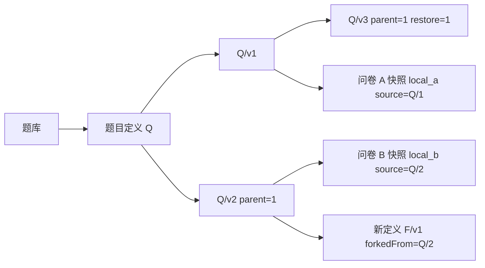

# 从问卷快照到独立题目版本

第一阶段主要读取和发布一份完整问卷，题型、选项、校验和路由嵌入 survey_versions，答卷独立保存。第二阶段增加了题目的独立生命周期：创建、共享、修改、恢复，以及在多个问卷中使用和统计。

问卷局部 ID 用于路由和答案定位，跨问卷复用则需要稳定的全局身份。仅凭标题或复制后的内容，很难区分共同来源、不同版本和偶然同名的题目。

## 方案比较

|方案|收益|需要解决的问题|
|---|---|---|
|复制内容|延续原有填写路径|共同身份与版本来源难以追踪|
|引用最新内容|内容集中维护|更新会改变旧问卷的题意与答案解释|
|定义内嵌历史|单题历史集中读取|历史持续增长、文档 16 MiB 上限及写入竞争|
|稳定定义、独立版本、问卷快照|身份和历史可追踪，问卷读取稳定|维护来源与快照内容的一致性|

系统采用最后一种方案：question_definitions 保存身份与权限，question_versions 保存具体内容，question_banks 组织成员引用。原问卷快照继续承担填写和历史解释，新题目身份承担共享与演进。



## 身份、内容与局部实例

版本号在同一题目下递增，parentVersion 记录实际派生起点，因而 v3 可以来自 v1。恢复追加一个包含旧内容的新版本；fork 创建新的全局身份，并在定义中记录 forkedFrom。

题库成员持有题目引用，可以固定版本，也可以在选题时读取 currentVersion。导入时确定精确版本并物化到问卷，生成局部 ID。问卷路由继续引用局部 ID，由问卷实例独立配置。

固定来源便于追踪和聚合，内嵌快照便于保留历史内容。两者配合后，库题更新、归档和共享变化影响后续选用，已发布问卷仍使用原快照。

## 与原模型的衔接

新增 source 为可选字段，statisticsContribution 缺省为 false，schemaVersion 继续为 1。原本地题沿原流程保存；用户可明确将其保存为常用题。

改动集中于原模型、MongoDB 验证器、问卷服务和前端，新增题目、题库、跨问卷统计服务。原认证、规则引擎、答卷提交和单问卷统计职责保留。主要文件与各轮改动见[变更记录](change-log.md)，完整字段和索引见[数据库设计](../database-design.md)。

可以通过以下命令比较第一阶段基线：

```powershell
git diff project1-baseline-61e2263 -- source/app
```
