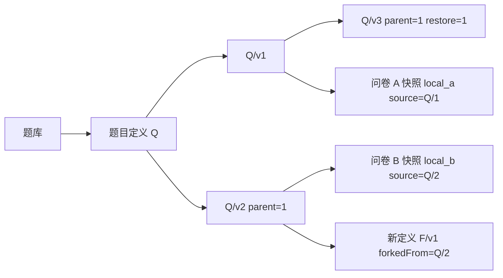

# 从问卷内嵌题目到稳定题目身份

第一阶段的访问中心是“完整读取一个问卷版本”：四类题、选项、校验、局部跳转一起嵌入 survey_versions，答卷独立增长。这个聚合边界继续适用于填写和历史解释。新需求增加了第二种生命周期：一道题需要脱离某份问卷独立创建、共享、演进和统计。仅有局部 questions[].id 无法证明两份问卷使用了同一题，标题相同更不能充当身份依据。

|方案|收益|不足|结论|
|---|---|---|---|
|纯复制粘贴|完全延续原填写路径|丢失题目身份、共享与版本谱系，无法可靠跨问卷统计|不满足新需求|
|只引用可变最新题|内容集中、改动传播简单|修改会改变历史问卷，旧答案失去解释依据|不采用|
|定义文档内嵌全部历史|单题历史一次读取|历史无界增长、并发争用、文档16MiB上限|不采用|
|稳定定义＋独立不可变版本＋问卷快照|身份/历史可追踪，填写独立稳定|有受控内容冗余，需要来源一致性验证|采用|

新增 question_definitions 管理所有者、共享范围、当前指针；question_versions 管理不可变内容及父版本；question_banks 管理个人有界引用。原四集合职责保留，不拆选项、规则和答案为零散集合。新的嵌入与引用边界反映生命周期，而非机械地模拟关系数据库多表。

版本号只在同题下有意义；v3 可从 v1 派生，不能把版本顺序误当直接父子关系。恢复追加新内容，fork 创建新身份。题库未固定版本时，在选择那一刻解析 currentVersion；导入接口仍要求精确版本。问卷路由引用局部 ID，因此只属于问卷实例。

来源快照的冗余是有意的：即使撤销共享、归档或库题升级，历史填写仍只读冻结版本。新增来源字段可缺省，旧数据不迁移含义。数据库 schemaVersion 保持1；业务 questionVersion、surveyVersion 与草稿 revision 三者职责不同。

代码对照：原位扩展 models/domain.py、models/documents.py、db/mongo.py、services/surveys.py、原前端；新增三个独立服务和一个路由模块。规则引擎、认证、提交、单问卷统计业务代码未改。精确差异可执行 `git diff project1-baseline-61e2263 -- source/app`；完整现行字段和索引见 [数据库设计](../database-design.md)。
