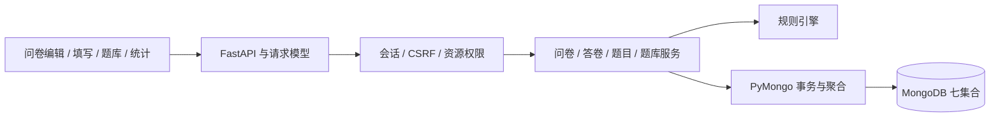

# 系统设计

问卷工坊使用 FastAPI 提供同源网页和 JSON API，前端由 HTML、CSS 和原生 JavaScript 组成。同步 PyMongo 操作由 FastAPI 线程池执行，规则计算与持久化逻辑分别放在规则引擎和业务服务中。

文件入口见[源码导航](../source/app/README.md)，字段和关系见[数据库设计](database-design.md)。

## 模块职责

|模块|职责|
|---|---|
|`main.py`、`core/`|应用装配、配置、会话、请求边界与异常响应|
|`models/`、`db/mongo.py`|请求模型、BSON 映射、集合验证器、索引和事务|
|`rules/engine.py`|题目配置、答案、条件匹配和填写路径|
|`services/surveys.py`|问卷、草稿、统一保存、导入、发布和关闭|
|`services/submissions.py`、`statistics.py`|幂等提交、有效答卷选择、列表与单问卷统计|
|`services/questions.py`|题目身份、版本、恢复、fork、共享与来源校验|
|`services/question_banks.py`|题库、成员及选题时的版本解析|
|`services/question_statistics.py`|使用关系和精确版本的跨问卷聚合|
|`api/`、`static/`、`templates/`|HTTP 入口、页面交互和样式|

写入依次经过身份验证、请求模型、业务校验和数据库约束。读取结果通过响应字段选择和统一序列化转换为 JSON；规则与服务可直接由测试调用。

## 身份与数据可见性

用户名经过 NFKC、去除首尾空白和 casefold 归一化，长度为 3–40 位，支持中英文、数字、下划线和短横线。密码为 10–128 字符，使用 Argon2id 哈希，参数为 t=2、m=19456 KiB、p=1。

会话使用时间签名 Cookie，包含 uid、csrf 和 sessionVersion，设置 HttpOnly、SameSite=Lax，默认有效期 8 小时；生产配置使用 HTTPS 和 Secure。退出时递增用户的 sessionVersion，使已有会话失效。状态修改请求携带 X-CSRF-Token，服务端同时检查 Origin；登录和注册也检查显式 Origin。

管理接口按资源所有者授权。题目共享提供读取与复用能力，独立维护通过 fork 完成；问卷数据贡献则由问卷所有者单独设置。公开链接提供当前问卷的填写入口，填写者仍先登录。

答卷列表按每份记录的 anonymousAtSubmission 决定身份展示。匿名记录返回版本、时间和答案；非匿名记录补充 respondentId 和当前用户名。用户名在同一 snapshot 事务中按当前页批量查询，关联账号缺失时返回 null。匿名设置的后续变化不影响历史记录的展示，填写者在自由文本中提交的内容仍保留。

网页使用转义或 textContent 显示动态内容。请求体上限为 2 MiB，覆盖普通和流式请求。验证错误返回字段位置和消息，数据库异常统一映射为服务不可用。

## 问卷保存与发布

创建问卷时，元信息与 V1 草稿在同一事务中写入。派生草稿从当前发布版本复制，版本号为 publishedVersion+1；并发派生会取得同一份现存草稿。

编辑器通过 `POST /api/surveys/{id}/save` 同时保存元信息与草稿。元信息约束、重复策略锁、草稿 expectedRevision、来源一致性及权限锁写入共用一个事务，成功后返回 survey 和新 revision 的 draft。旧 PATCH 元信息与 PUT 草稿接口仍分别可用；无草稿或冻结草稿的元信息编辑使用 PATCH。

前端在服务器确认后显示保存成功。保存冲突时保留输入，并提示获取最新草稿；预览和发布等待保存成功再继续。网络结果不确定时，页面提示核对保存状态后重试。

发布先验证整份配置，按 revision 冻结为 sealed，再切换 surveys 的公开指针。冻结后中断时，原公开版本继续服务，沿用同一 revision 重试即可完成发布。关闭状态参与指针更新条件。

## 题目版本与问卷导入

题目定义保存稳定身份和共享范围，具体内容按版本追加。恢复复制旧版内容并生成新版本；fork 创建新的题目身份。问卷内保留固定版本来源和完整内容快照，填写、提交与历史解释均读取问卷快照。

导入在一个事务中完成：

1. 检查问卷所有者、草稿状态和 expectedRevision。
2. 检查题目权限、归档状态和具体版本。
3. 写入题目定义 revision，与共享撤销或归档操作形成并发协调。
4. 生成局部实例，或显式替换已有实例。
5. 复用规则引擎校验整卷，按草稿 revision 更新。

事务重试会重新检查权限。已有来源快照在撤销共享后仍可保存，新导入或版本替换按当前权限判断。来源题的核心内容与库中固定版本一致，用户通过解除关联或选择新版本修改题意；问卷路由由局部实例独立维护。

题库成员可固定版本，也可在选题时解析最新版。选择器使用 `activeOnly=true`，由 MongoDB 先过滤归档题再搜索、分页和计数；题目管理页使用默认列表查看全部题目。

## 提交与统计

提交使用 snapshot/majority 事务。服务先检查幂等键与摘要，再验证问卷状态、截止时间、版本和答案路径，更新 hasSubmissions/writeRevision 并追加答卷。提交与策略修改、关闭、发布共同写入问卷文档，冲突后重新读取状态。

`latest_only` 先在整份问卷的全部版本中选每人最新提交，再筛选目标版本；`multiple` 和历史原始口径保留相应提交。统计和答卷列表使用只读 snapshot，响应中的计数、均值和明细来自同一快照。

跨问卷统计按题目身份和精确版本关联局部答案。`mine` 汇总本人问卷，`consented_shared` 加入显式贡献的数据；每份外部问卷至少 3 次实际回答后参与聚合。`surveyCount` 表示当前口径下有提交参与统计的去重问卷数，使用关系则按可见问卷版本记录展示。完整字段、跳题和跨版本替代的处理见[数据库设计](database-design.md#统计口径)。

## 扩展方向

增加题型时，可沿请求模型、规则引擎、前端控件和统计服务扩展。数据规模增长后，可进一步评估问卷写入竞争、统计缓存与预聚合。当前运行和验证范围见[测试记录](project2/test-report.md)。
