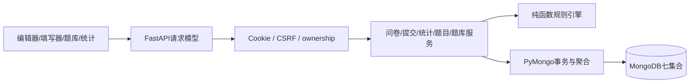

# 系统设计与关键逻辑

系统采用前后端分离的组织方式。浏览器使用HTML、CSS和原生JavaScript，通过同源JSON API访问FastAPI。数据库操作使用同步PyMongo，由FastAPI线程池执行。main负责装配应用、中间件、错误处理和页面入口，业务规则由独立模块处理。

写入：认证→严格请求模型→权限/状态检查→规则规范化→Pydantic BSON文档→Mongo JSON Schema/唯一索引。读取：数据库查询/聚合→明确DTO→统一ObjectId/UTC序列化。engine/service都可脱离Web直接测试。

## 身份与匿名

用户名经NFKC、trim和casefold归一化，长度为3..40位，支持中英文、数字、下划线和短横线。密码长度为10..128字符，采用Argon2id哈希（t=2、m=19456KiB、p=1）。会话使用itsdangerous时间签名，Cookie设置HttpOnly和SameSite=Lax，默认有效期8小时；生产配置使用Secure和HTTPS。Cookie包含uid、csrf和sessionVersion，退出时递增users.sessionVersion，使该账号已有会话失效。

状态变更要求X-CSRF-Token，/api/me返回当前令牌。登录/注册同样拒绝显式外域Origin。管理端检查ownerId，公开链接只赋予填写入口；已登录用户填写别人的问卷是正常路径。身份、提交时间、匿名快照由服务器决定，多余字段拒绝。用户数据不作为任意Mongo filter。DOM textContent/转义防XSS。普通/流式请求均限制2MiB。验证错误不回显密码或原始输入；Mongo错误只记录异常类型，不返回堆栈。

答卷接口通过明确的DTO组织返回字段。匿名记录包含答卷ID、版本、时间和答案；非匿名记录增加respondentId和respondentUsername。用户名由当前页的去重用户ID批量查询，并与答卷列表共用snapshot事务。requestId和摘要用于内部处理。每份答卷的身份展示由anonymousAtSubmission决定，因此V2改为实名后，V1匿名答卷仍保持原有展示方式。匿名保护针对账号身份，自由文本保留填写者提交的内容。

## 版本与并发

创建问卷时，元数据和V1草稿在同一事务中提交。保存草稿根据surveyId、draftVersion、state和revision进行条件更新。新草稿从当前发布版本复制，版本号为publishedVersion+1；并发派生时返回同一份现存草稿。

发布先执行静态验证，再按revision冻结为sealed，最后切换surveys的公开指针。若冻结后中断，原公开版本继续服务，再次publish完成恢复。关闭状态参与指针更新条件，保持关闭后的问卷状态。

提交在snapshot/majority事务中进行：先查询幂等键并比较摘要，新请求依次检查状态、截止时间和版本，再重算填写路径、更新hasSubmissions/writeRevision并插入答卷。提交与策略修改、发布和关闭共同写入survey文档，冲突后重读状态。成功请求的网络重试返回原记录。

统计和所有者列表使用只读snapshot事务，保证一次响应中的计数、均值和明细来自同一数据快照。latest_only先在整份问卷中选择每人的最新提交，再筛选版本；historical_raw直接查询指定版本的记录。文本和数字明细分页展示，均值及回答数基于全部选中答卷计算。最新记录按submittedAt和_id排序；页面通过刷新获取后续提交。

## 后续扩展

schemaVersion表示数据库文档格式，version表示问卷内容版本。后续增加题型或操作符时，可沿现有模型、规则引擎、前端控件和统计服务扩展，并通过回归测试保持历史数据兼容。数据量增长后，需要进一步评估共享问卷文档的写入竞争、统计缓存和预聚合更新方式。

## 第二阶段模块协作

新增 `services/questions.py` 管理身份、可见性、共享、不可变版本、恢复、fork 和来源一致性；`question_banks.py` 管理有界题库引用；`question_statistics.py` 负责反查及精确版本跨问卷聚合；`api/question_routes.py` 复用原认证依赖和错误边界。原 `services/surveys.py` 增加来源校验和 import_question；草稿保存改为事务，以便来源授权检查与 CAS 一同提交。原规则引擎、提交服务、统计服务和认证服务继续承担原职责。

导入事务：验证问卷所有者及草稿 revision → 验证题目共享/归档及精确版本 → 写题目定义 revision（与撤销共享争用同一文档）→ 生成/替换局部实例 → 复用规则引擎验证整卷 → 更新草稿 CAS。事务重试后重检权限。共享和题库成员编辑也有显式 revision；过期值返回 409，不丢失更新。已存在的合法来源快照允许在共享撤销后继续保存，不让原问卷因外部权限变化失效。

题目界面在原 app.js 上扩展；同一导航提供我的题目/共享题、版本、恢复、fork、共享、归档、题库、反查和统计。问卷编辑器提供选题和明确解除关联；来源题核心字段锁定，路由仍独立编辑。所有动态内容继续转义，状态请求沿用 CSRF/Origin 校验，移动端 390px 端到端检查无水平溢出。

贡献授权是问卷级独立设置，默认关闭；统计服务在只读 snapshot 中计算授权集合、抑制范围和结果，避免同一次响应前后漂移。题目创建者不能凭“题目被使用”访问其他创建者的原始答卷。详细口径见 [数据库设计](database-design.md)，升级见 [迁移](project2/migration.md)。
