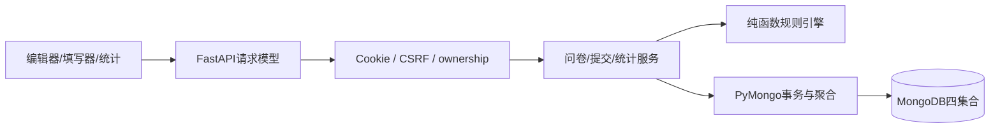

# 系统设计与关键逻辑

浏览器加载HTML/CSS/原生JS，以同源JSON API连接FastAPI。同步def路由在线程池中调用同步PyMongo，不在异步事件循环内执行阻塞数据库查询。main只装配应用、middleware、错误和页面入口。

写入：认证→严格请求模型→权限/状态检查→规则规范化→Pydantic BSON文档→Mongo JSON Schema/唯一索引。读取：数据库查询/聚合→明确DTO→统一ObjectId/UTC序列化。engine/service都可脱离Web直接测试。

## 身份与匿名

用户名NFKC+trim+casefold，允许3..40位中英文/数字/_/-。密码10..128字符，Argon2id(t=2,m=19456KiB,p=1)。会话itsdangerous时间签名，HttpOnly、SameSite=Lax、默认8小时；生产必须Secure/HTTPS、强随机配置密钥。Cookie包含uid/csrf/sessionVersion；退出递增users.sessionVersion，撤销此前全部会话，复制Cookie也不可重用，无需第五个集合。

状态变更要求X-CSRF-Token，/api/me返回当前令牌。登录/注册同样拒绝显式外域Origin。管理端检查ownerId，公开链接只赋予填写入口；已登录用户填写别人的问卷是正常路径。身份、提交时间、匿名快照由服务器决定，多余字段拒绝。用户数据不作为任意Mongo filter。DOM textContent/转义防XSS。普通/流式请求均限制2MiB。验证错误不回显密码或原始输入；Mongo错误只记录异常类型，不返回堆栈。

匿名答卷采用allowlist DTO：id/版本/匿名/时间/答案，只有非匿名才增加respondentId；不输出用户名、requestId、digest或账号映射。统计没有用户关联查询。anonymousAtSubmission保留原提交承诺，V2实名不解除V1匿名。自由文本可由填写者主动透露身份，不提供绝对不可识别保证。

## 版本与并发

创建问卷和V1在事务中共同提交；草稿按(surveyId,draftVersion,state=draft,revision) CAS更新。派生在事务内写survey和唯一版本，采用publishedVersion+1；并发派生返回同一现存草稿，不用count()+1。

发布：静态验证→按revision冻结sealed→CAS切surveys公开指针。冻结后中断时draftVersion仍指sealed、公开指针不变，重复publish恢复；sealed内容不可编辑。关闭与切指针竞争，发布不能重开关闭问卷。

提交在snapshot/majority事务中：先查幂等键并比较摘要→新请求检查关闭/服务器UTC截止/版本→服务器重算路径→写survey.hasSubmissions和writeRevision→插入新答卷。与策略修改、发布和关闭争用同一survey，冲突后重读状态，防止先检查后写入的竞态。已有成功请求在关闭/切版后重试仍确认原记录，不新建答卷。

统计/所有者列表使用只读snapshot事务，单次响应的计数/均值/明细来自同一快照。页面多个HTTP响应不共享快照，新提交后刷新更新。latest_only先全卷按用户选最新，再筛版本；historical_raw不去重；文本/数字明细分页，均值/人数基于全部选中记录。submittedAt+_id确定性排序，不承诺客户端点击/网络到达顺序。

## 演进与限制

schemaVersion是数据库格式，version是内容；不可变版本让旧答案始终可解释。第二阶段增加题型/操作符时扩展模型、engine、UI和统计分派，保留旧格式解释与回归测试。课程规模下每卷共享写文档和按题聚合可接受；大规模应评估热点、缓存和预聚合失效机制。本次未执行容量压测或公网部署。
